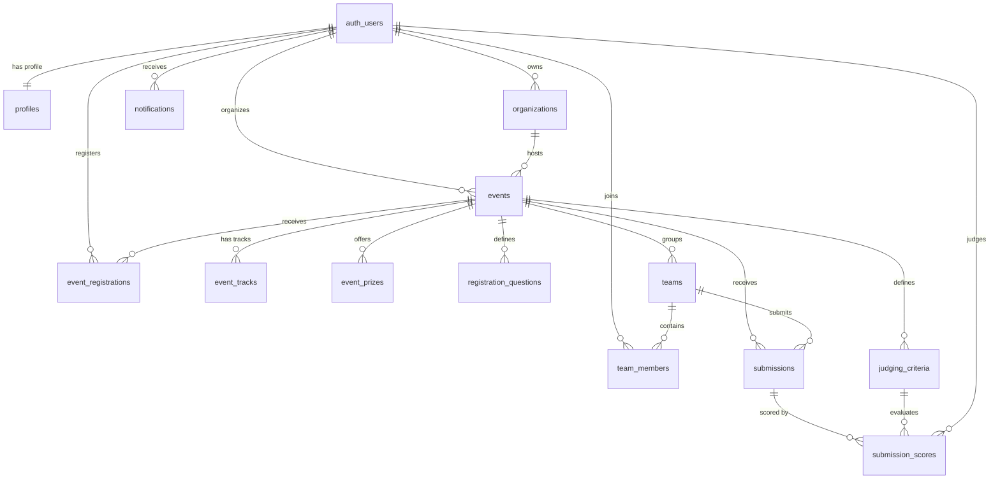

# NearCircle Database Design & Architecture Document

This document provides a comprehensive specification of the NearCircle PostgreSQL schema, Row Level Security (RLS) policies, data integrity triggers, and role-based access control.

---

## 1. Schema Architecture Overview

NearCircle's database architecture is built on PostgreSQL with Supabase, maintaining strict compatibility with the existing community schema (`supabase/migrations/20261024_community_schema.sql`). 

The schema is divided into three tiers:
1. **Identity & Authorization**: User profiles, account roles (`participant`, `organizer`, `judge`, `admin`), and organizations.
2. **Event & Hackathon Core**: Events, tracks, prizes, registration questions, atomic registrations, and teams.
3. **Execution & Evaluation**: Submissions, judging criteria, assignments, scores, participant notifications, and administrative audit logging.



---

## 2. Table Specifications & Relationships

### 1. `public.profiles`
Stores user profile information and authority role. Linked 1:1 with `auth.users(id)`.
- **Columns**:
  - `id` (uuid, PK, references `auth.users(id)` on delete cascade)
  - `role` (text, check `role in ('participant', 'organizer', 'judge', 'admin')`, default `'participant'`)
  - `full_name` (text, not null)
  - `avatar_url` (text)
  - `headline` (text)
  - `bio` (text)
  - `website_url`, `github_url`, `linkedin_url` (text)
  - `skills` (text[], default `array[]::text[]`)
  - `created_at`, `updated_at` (timestamptz, not null)
- **Integrity Trigger `tr_protect_profile_role`**: Prevents users from updating their own `role` column. Only `service_role` or existing `admin` accounts can change a user's role.
- **Auto-Provision Trigger `on_auth_user_created`**: When a user registers in `auth.users`, a profile row is automatically inserted with `participant` or `organizer` role.

### 2. `public.organizations` (Extended from existing schema)
Preserves all columns from `20261024_community_schema.sql` (`name`, `slug`, `logo_url`, `accent_color`, `description`, `category`, `locality_id`, `is_verified`, `follower_count`) and adds:
- `owner_id` (uuid, references `auth.users(id)` on delete set null)
- **Integrity Trigger `tr_protect_organization_verification`**: Prevents organizers from toggling `is_verified`. Only platform administrators or `service_role` can verify an organization.

### 3. `public.events`
Represents hackathons, workshops, and campus meetups.
- **Columns**:
  - `id` (uuid, PK)
  - `slug` (text, unique, not null)
  - `title` (text, not null)
  - `description` (text, not null)
  - `category` (text, not null)
  - `poster_url` (text)
  - `starts_at`, `ends_at` (timestamptz, not null, check `ends_at >= starts_at`)
  - `venue_name`, `address`, `locality_id` (text, not null)
  - `lat`, `lng` (double precision, not null)
  - `price` (numeric, default 0, check `>= 0`)
  - `capacity` (integer, default 0, check `>= 0`; 0 = unlimited)
  - `status` (text, check `status in ('draft', 'published', 'completed', 'cancelled')`, default `'draft'`)
  - `owner_id` (uuid, not null, references `auth.users(id)`)
  - `organization_id` (uuid, references `public.organizations(id)`)
  - `organizer_name` (text, not null)
  - `registration_deadline`, `submission_deadline` (timestamptz)
  - `min_team_size` (integer, default 1, check `>= 1`)
  - `max_team_size` (integer, default 4, check `>= min_team_size`)
  - `rules`, `prizes_summary` (text)
  - `tags` (text[])
  - `is_demo` (boolean, default false)

### 4. Organization Track Record Function
`public.get_organization_completed_count(org_id uuid)`:
- Computes real completed/conducted event count based strictly on database records:
  ```sql
  select count(*)::integer from public.events
  where organization_id = org_id
    and (status = 'completed' or (status = 'published' and ends_at < now()));
  ```
- Draft, cancelled, and unverified/unrelated events are strictly excluded.

### 5. `public.event_tracks` & `public.event_prizes`
- `event_tracks`: Specific hackathon tracks (e.g. "Fintech", "AI & Healthcare", "Open Innovation").
- `event_prizes`: Reward amounts, currency, track mappings, and titles.

### 6. `public.event_registrations`
- Unique registration per participant per event: `unique (event_id, user_id)`.
- `status`: `'confirmed' | 'cancelled' | 'waitlisted' | 'checked_in'`.
- `ticket_code`: Unique ticket code for admission.
- `custom_answers`: jsonb payload storing answers to `registration_questions`.
- **Integrity Trigger `tr_validate_event_registration_capacity`**: Atomically verifies available capacity prior to registration insertion, preventing overbooking under concurrent access.

### 7. `public.teams`, `team_members`, `team_invites`
- Model hackathon team participation.
- `unique (event_id, name)`: Unique team name per event.
- `team_members`: Links team members with roles (`leader`, `member`).
- **Integrity Trigger `tr_validate_team_size_limit`**: Checks `events.max_team_size` and prevents additions exceeding the configured threshold.

### 8. `public.submissions`
- Project submissions for evaluation.
- `status`: `'draft' | 'submitted' | 'under_review' | 'winner' | 'disqualified'`.
- Fields for project title, tagline, description, demo URL, GitHub repository URL, presentation video URL, cover image, and technology tags.

### 9. `public.judging_criteria`, `judge_assignments`, `submission_scores`
- Normalized evaluation framework:
  - `judging_criteria`: Weighted criteria per event (e.g. Innovation: 30%, Execution: 40%).
  - `judge_assignments`: Maps authorized judges to events or specific tracks.
  - `submission_scores`: Scores and qualitative feedback submitted by assigned judges.

### 10. `public.notifications` & `public.audit_logs`
- User notifications for registration confirmations, submission alerts, and invitations.
- Tamper-resistant audit log recording sensitive actions (e.g. organization verification, submission disqualification, event publication).

---

## 3. Row Level Security (RLS) Policy Matrix

| Table | Visitor (Public) | Participant | Event Organizer | Judge | Administrator |
| :--- | :--- | :--- | :--- | :--- | :--- |
| `profiles` | Read basic | Read / Update own | Read / Update own | Read / Update own | Read all / Update roles |
| `organizations` | Read verified/public | Read / Follow | Create / Update own | Read / Follow | Manage all + Verification |
| `events` | Read published/ended | Read published | Manage own events | Read assigned | Manage all events |
| `event_registrations` | No access | Manage own (read/cancel) | View/Check-in for own events | View event registrants | Full access |
| `teams` | No access | View/Join/Lead own | View event teams | View assigned teams | Full access |
| `submissions` | Read public/winners | Create/Edit own team's | View all event submissions | View/Score assigned | Full access |
| `submission_scores` | No access | No access | View aggregated scores | Submit/Edit assigned scores | Full access |
| `notifications` | No access | Read/Manage own | Read/Manage own | Read/Manage own | Full access |
| `audit_logs` | No access | No access | No access | No access | Read all logs |

---

## 4. How to Apply Migrations Safely

### Method A: Via Supabase Dashboard (Recommended for Cloud Projects)
1. Open [Supabase Dashboard](https://supabase.com/dashboard).
2. Go to **SQL Editor** → **New Query**.
3. Run the migrations in chronological order:
   - Run `supabase/migrations/20261024_community_schema.sql` (if not already applied).
   - Run `supabase/migrations/20261025_nearcircle_core_schema.sql`.
4. Inspect the **Table Editor** to confirm all 14 tables and RLS policies are active.

### Method B: Via Supabase CLI (Local Development)
```bash
# Start local Supabase containers (if running locally with Docker)
supabase start

# Apply all migrations
supabase db reset
# Or push pending migrations
supabase db push
```

---

## 5. Validation & Non-Destructive Integrity Checks
- **No Table Drop**: Existing `organizations`, `organization_follows`, `community_posts`, `post_likes`, `post_comments`, and `post_reports` are preserved without dropping data.
- **UUID & Type Consistency**: All identifiers use `uuid` with `default gen_random_uuid()` or `references auth.users(id)`.
- **Constraint Safety**: All checks use non-negative or enum validations.
- **Index Optimization**: Composite and single indexes are placed on all foreign keys, status filters, and search columns.
