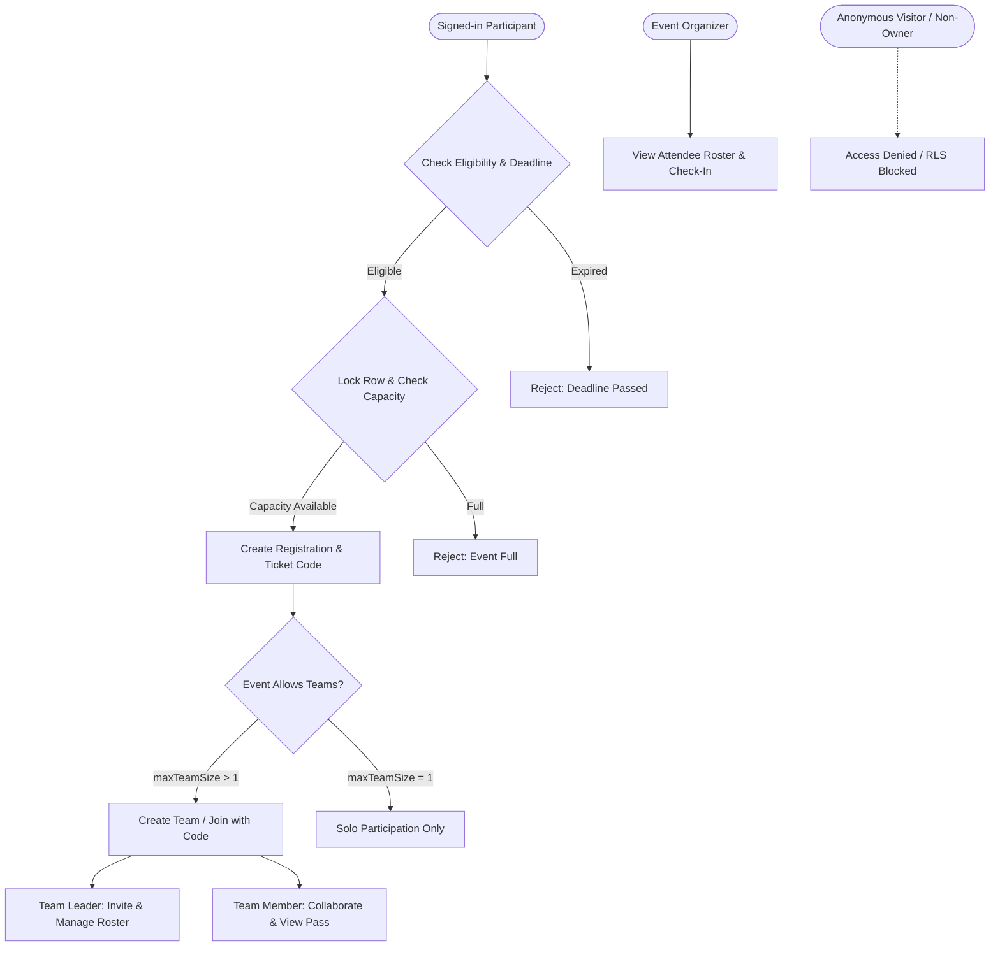

# Phase 7: Event Registrations and Team Management

## Architecture & System Overview

Phase 7 delivers end-to-end registration and team management capabilities for NearCircle, implementing atomic database procedures, trigger-enforced capacity and size constraints, role-based authorization, and real UI workflows for participants and organizers.



---

## 1. Registration Workflows & Concurrency Safeguards

### Database Procedure: `register_for_event(p_event_id, p_custom_answers)`
- **Row-Level Locking**: Executes `SELECT ... FROM public.events WHERE id = p_event_id FOR UPDATE` to prevent race conditions during high-concurrency registration spikes.
- **Deadline Enforcement**: Verifies `events.registration_deadline IS NULL OR events.registration_deadline > NOW()`.
- **Capacity Limits**: Checks active confirmed and checked-in registrations against `events.capacity`.
- **Duplicate Prevention**: Strictly validates `(event_id, user_id)` uniqueness. Reactivates previously cancelled registrations if re-registering, preserving historical audit integrity.
- **Unique Ticket Generation**: Generates deterministic uppercase ticket codes (`NC-XXXXXXXX`).

### Database Procedure: `cancel_event_registration(p_event_id)`
- Verifies authentication and active registration status.
- Sets registration status to `'cancelled'` and frees capacity for subsequent participants.
- Automatically removes the participant from any teams attached to that event.

---

## 2. Team Management & Membership Constraints

### Database Trigger: `tr_validate_event_team_membership`
- Enforces cross-team isolation: a participant cannot join or lead multiple teams for the same hackathon.
- Prevents split registrations and double-submissions.

### Database Trigger: `tr_validate_team_size_limit`
- Enforces `events.max_team_size` dynamically whenever a new team member is added.
- Rejects joins once maximum capacity is reached.

### Team Roles & Authorization
- **Leader Permissions**:
  - Automatically assigned to team creator upon creation.
  - Can generate or share 6-character alphanumeric invite codes (`TEAM-XXXXXX`).
  - Can invite members via email address (`team_invites`).
  - Can remove members from the team roster.
  - Can disband the team.
- **Member Permissions**:
  - Can join via invite code or respond to pending invitations.
  - Can view team roster and invite code.
  - Can leave the team.
- **Solo Participation**:
  - Events with `max_team_size = 1` strictly reject team creation attempts and display the solo badge.

---

## 3. Organizer Attendee Roster Isolation

### Database Procedure: `get_event_attendees(p_event_id)`
- Restricted strictly to `events.owner_id = auth.uid()` or system administrators.
- Anonymous visitors and non-owner participants are rejected at both RLS and procedure levels.
- Returns attendee names, emails, registration status (`confirmed`, `checked_in`), ticket codes, and attached team details.
- Allows event organizers to toggle participant check-in status directly in the dashboard.

---

## 4. UI Components & Pages

| Component / Page | Location | Description |
| :--- | :--- | :--- |
| [`RegistrationModal`](file:///c:/Users/Dell/Downloads/nearcircle/src/components/events/RegistrationModal.tsx) | `src/components/events/RegistrationModal.tsx` | Interactive modal with deadline/capacity validation, rules consent, custom questions, and digital entry pass issuance. |
| [`TeamSection`](file:///c:/Users/Dell/Downloads/nearcircle/src/components/teams/TeamSection.tsx) | `src/components/teams/TeamSection.tsx` | Team creation, join-with-code, roster view, invite code copying, and leader controls embedded directly on event details. |
| [`AttendeeListModal`](file:///c:/Users/Dell/Downloads/nearcircle/src/components/events/AttendeeListModal.tsx) | `src/components/events/AttendeeListModal.tsx` | Organizer dashboard modal with attendee roster, search filter, check-in toggling, and team indicators. |
| [`EventDetailsPage`](file:///c:/Users/Dell/Downloads/nearcircle/src/pages/EventDetailsPage.tsx) | `src/pages/EventDetailsPage.tsx` | Upgraded with real registration detection, digital pass summary, and dynamic team management. |
| [`MyEventsPage`](file:///c:/Users/Dell/Downloads/nearcircle/src/pages/MyEventsPage.tsx) | `src/pages/MyEventsPage.tsx` | Displays confirmed registrations with ticket passes, QR placeholders, team membership badges, and cancellation modals. |
| [`OrganizerDashboardPage`](file:///c:/Users/Dell/Downloads/nearcircle/src/pages/OrganizerDashboardPage.tsx) | `src/pages/OrganizerDashboardPage.tsx` | Added "Attendees" management action for published and completed events. |

---

## 5. Verification & Test Results

The automated test suite in [`scripts/test-phase7.ts`](file:///c:/Users/Dell/Downloads/nearcircle/scripts/test-phase7.ts) validates all security, concurrency, and business logic constraints:

```
=================================================================
  NearCircle Phase 7: Registrations & Team Management Test Suite 
=================================================================

  ✓ [PASS] Eligible signed-in participant can register and receive unique ticket pass
  ✓ [PASS] Prevents duplicate registration attempts for the same event
  ✓ [PASS] Rejects registration attempts when deadline has passed
  ✓ [PASS] Enforces event capacity limits and rejects registration once full
  ✓ [PASS] Cancelling a registration frees capacity and allows new participants to register
  ✓ [PASS] Anonymous visitors are rejected from registering or joining teams
  ✓ [PASS] Participants can only view their own registrations in My Events
  ✓ [PASS] Registered participant can create a team and becomes team leader
  ✓ [PASS] Events configured for solo participation reject team creation
  ✓ [PASS] Joining a team enforces maximum team size limit
  ✓ [PASS] Participant cannot join or create multiple teams for the same event
  ✓ [PASS] Restricts team management and member removal to authorized leader
  ✓ [PASS] Event organizer can access attendee roster; unauthorized users are rejected

=================================================================
    Phase 7 Test Results: 13 Passed, 0 Failed
=================================================================
```
