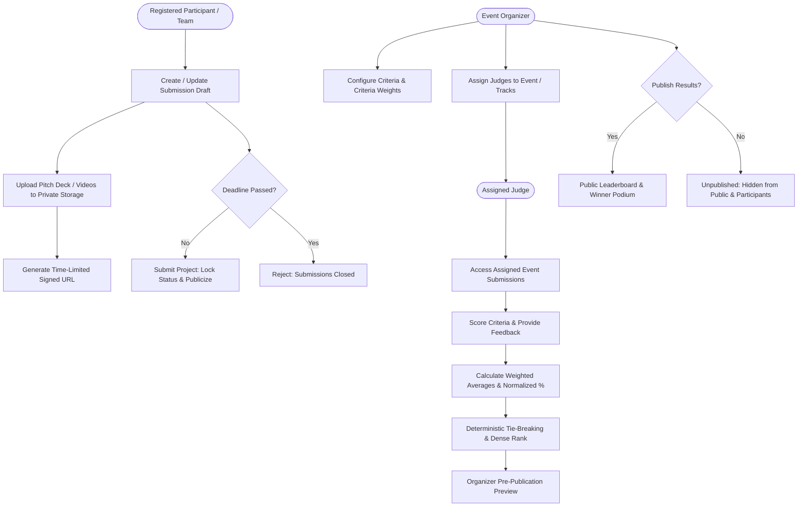

# Phase 8 & 9: Project Submissions, Supabase Storage, and Judging/Scoring

## Architecture & System Overview

Phase 8 and Phase 9 provide the core competitive workflows of NearCircle: project submission drafts, multi-file storage with signed URLs, deadline locking, organizer judging setup, rubric-based score evaluations, weighted score calculations with deterministic tie-breaking, and official results publication.

---

## 1. Project Submission Workflows

### Database Procedures & Constraints
- **Prerequisite Validation (`tr_validate_submission_rules`)**:
  - Participant must hold a confirmed or checked-in registration for the event before creating drafts.
  - Team members can only submit projects associated with their active team (`team_id`).
  - Solo participants submit with `submitter_id` and null `team_id`.
- **Atomic Uniqueness**:
  - `idx_unique_team_submission`: Ensures each team can only have one submission per event.
  - `idx_unique_solo_submission`: Ensures a solo participant cannot create multiple submissions for the same event.
- **Deadline Enforcement**:
  - Both server and database triggers check `events.submission_deadline > NOW()`.
  - Rejects creation, modifications, or final submissions once the deadline has passed.
  - Submissions cannot be deleted once finalized.
- **Submission Fields**:
  - `title`, `tagline`, `description`
  - `demo_url`, `repo_url`, `video_url`
  - `technologies` (string array tags)
  - `track_id` (track selection)
  - `files` (`file_urls` array containing name, size, MIME type, storagePath, isPrivate)
  - `status`: `'draft'` | `'submitted'` | `'under_review'` | `'accepted'` | `'rejected'` | `'winner'`

---

## 2. Supabase Storage Architecture

NearCircle isolates public marketing assets from sensitive competitive project deliverables using two dedicated buckets:

### Bucket Definitions

| Bucket Name | Access Level | Max File Size | Allowed MIME Types | Intended Content |
| :--- | :--- | :--- | :--- | :--- |
| `public-assets` | Public Read | 5 MB | PNG, JPEG, WebP, SVG | Event banners, organization logos, avatars |
| `project-submissions` | Private (Signed URLs) | 25 MB | PDF, ZIP, MP4, WebM, PNG, JPEG, WebP, JSON, TXT | Architecture docs, pitch decks, demo videos, repos |

### Access Control & Signed URLs
- **Upload Isolation**: File storage paths follow hierarchical naming: `events/<eventId>/<submissionId>/<userId>/<timestamp>-<filename>`.
- **Overwriting Protection**: Users are prevented from overwriting or deleting storage objects owned by another participant.
- **Signed URLs**: Private files generate time-limited signed URLs (`supabase.storage.from('project-submissions').createSignedUrl(path, expiresIn)`).
- **MIME & Size Validation**: Enforced both client-side and server-side in `storageService.validateFile()` and through Supabase Storage RLS policies.

### Manual Supabase Storage Setup Steps
If deploying to a fresh Supabase project:
1. Open the **Supabase Dashboard** -> **Storage**.
2. Create bucket `public-assets` with **Public bucket** enabled. Set file size limit to `5MB` and allowed MIME types to `image/*`.
3. Create bucket `project-submissions` with **Public bucket** disabled (private). Set file size limit to `25MB`.
4. Apply the RLS policies defined in `supabase/migrations/20261025_phase8_phase9_submissions_and_judging.sql`.

---

## 3. Judging, Scoring & Leaderboard Rankings

### Organizer Judging Setup
- **Criteria Configuration**:
  - Organizers create weighted criteria: `title`, `description`, `weight` (decimal, default 1.0), `max_score` (integer, default 10), `display_order`.
  - Only event organizers and administrators can add, edit, or remove judging criteria.
- **Judge Assignments**:
  - Organizers assign judges by email address to the event (`judge_assignments`).
  - Track-specific judging is supported when `track_id` is assigned.
  - Judges only see and evaluate submissions for events they are explicitly assigned to.

### Scoring Validation & Idempotency
- **Bounds Check (`tr_validate_submission_score`)**:
  - Enforces `0 <= score <= criterion.max_score`.
  - Negative values or values exceeding `max_score` are strictly rejected.
- **Idempotent Updates**:
  - Submitting updated scores updates the judge's existing score entry (`(submission_id, judge_id, criterion_id)` unique index) rather than creating duplicates.
  - Private judge feedback notes (`feedback`) are recorded with timestamps.

### Ranking Calculation Formula

1. **Criterion Weighted Average**:
   For each criterion $c$ with weight $w_c$:
   $$\text{Average Score}_c = \frac{\sum_{j=1}^{N_c} \text{Score}_{j,c}}{N_c}$$
   $$\text{Weighted Criterion Score}_c = \text{Average Score}_c \times w_c$$

2. **Total Weighted Score**:
   $$\text{Total Weighted Score} = \sum_{c=1}^{K} \text{Weighted Criterion Score}_c$$

3. **Normalized Percentage**:
   $$\text{Normalized Percentage} = \left( \frac{\text{Total Weighted Score}}{\sum_{c=1}^{K} (\text{Max Score}_c \times w_c)} \right) \times 100$$

4. **Deterministic Tie-Breaking Cascade**:
   When two or more submissions achieve the exact same Total Weighted Score:
   - **Tie-Breaker 1**: Higher score in the highest-weighted criterion.
   - **Tie-Breaker 2**: Earlier final submission timestamp (`submitted_at ASC`).
   - **Tie-Breaker 3**: Shared dense ranking (e.g., 1, 2, 2, 4).

### Result Publication & Privacy
- **Toggle (`results_published`)**: Organizers control when results become public via `publishEventResults(eventId, boolean)` or the Organizer Judging Tab.
- **Protection of Unpublished Results**:
  - Public visitors and participants cannot view leaderboards or podiums while `results_published = false`.
  - Organizers can preview rankings and score breakdowns at any time.
- **Judge Privacy**:
  - Individual judge scores and qualitative feedback notes remain confidential to the judging team and event organizer; only aggregated breakdowns and totals appear on the public leaderboard.
